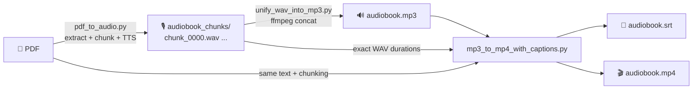

<div align="center">

# 🎧 PDF → Audiobook → Captioned Video

**Turn any PDF into a narrated audiobook (MP3) and a captioned video (MP4) — 100% local, free, no API keys.**
 


</div>

---

## ✨ What you get

| Input | Output |
|-------|--------|
| 📄 `your-document.pdf` | 🔊 `audiobook.mp3` — a single narrated audio file |
| | 📝 `audiobook.srt` — time-synced subtitles |
| | 🎬 `audiobook.mp4` — video with captions burned in (or as a selectable track) |

- 🔒 **Private** – your documents never leave your machine.
- ⚡ **Fast** – a 12-minute audiobook is generated in minutes on a consumer GPU (RTX 3050), and works on CPU too.
- 🎯 **Accurate captions** – timing comes from the real duration of every generated audio chunk, so there is no speech-recognition guesswork or drift.
- 🧩 **Three small, independent scripts** – easy to read, tweak, and re-run individually.

## 🗺️ How it works



1. **`pdf_to_audio.py`** – extracts the PDF text (PyMuPDF), splits it into ≤200-character chunks at sentence boundaries, and synthesises one WAV per chunk with the Coqui **VITS** model (`tts_models/en/ljspeech/vits`).
2. **`unify_wav_into_mp3.py`** – concatenates all WAVs, in order, into one MP3 with ffmpeg.
3. **`mp3_to_mp4_with_captions.py`** – re-creates the same chunks, reads each WAV's exact duration to build `.srt` captions, then renders an MP4 (black background + audio + captions).

---

## 🚀 Quick start

### 1. Prerequisites

| Requirement | Notes |
|-------------|-------|
| **Python 3.10 – 3.12** | [python.org/downloads](https://www.python.org/downloads/). Tested with 3.10.11. |
| **FFmpeg** (incl. `ffprobe`) on your `PATH` | Windows: `winget install Gyan.FFmpeg` · macOS: `brew install ffmpeg` · Linux: `sudo apt install ffmpeg` |
| **NVIDIA GPU + CUDA** *(optional)* | Much faster. Without one the scripts automatically fall back to CPU. |

Check that ffmpeg is installed:

```bash
ffmpeg -version
ffprobe -version
```

### 2. Clone and create a virtual environment

**Windows (PowerShell)**

```powershell
git clone https://github.com/<your-user>/<your-repo>.git
cd <your-repo>

python -m venv venv
.\venv\Scripts\activate
```

**macOS / Linux**

```bash
git clone https://github.com/<your-user>/<your-repo>.git
cd <your-repo>

python3 -m venv venv
source venv/bin/activate
```

> 💡 **Windows tip:** if `python -m venv venv` fails with `Permission denied: ...\venv\Scripts\python.exe`, a previous environment is still being used by another process (often VS Code, an open terminal, or antivirus). Close anything using the folder — or delete the `venv` folder — and run the command again.
>
> If PowerShell refuses to run `activate`, allow scripts for the current session with
> `Set-ExecutionPolicy -Scope Process -ExecutionPolicy Bypass`.

### 3. Install dependencies

**With an NVIDIA GPU (recommended)** — install the CUDA build of PyTorch first ([pick your CUDA version here](https://pytorch.org/get-started/locally/)):

```bash
pip install torch torchaudio --index-url https://download.pytorch.org/whl/cu124
pip install -r requirements.txt
```

**CPU only** (slower, but works everywhere):

```bash
pip install -r requirements.txt
```

Confirm what PyTorch sees:

```bash
python -c "import torch; print('CUDA available:', torch.cuda.is_available())"
```

### 4. Add your PDF

Put your PDF in the project folder and point the scripts at it.

- Open [pdf_to_audio.py](pdf_to_audio.py) and edit the constant near the top:

  ```python
  PDF_PATH = "my-book.pdf"
  ```

- The video script takes the PDF as a command-line flag (or edit `PDF_PATH` in [mp3_to_mp4_with_captions.py](mp3_to_mp4_with_captions.py)):

  ```bash
  python mp3_to_mp4_with_captions.py --pdf my-book.pdf
  ```

> ⚠️ Both scripts must read the **same PDF** with the same chunk size (`200` characters). The captions are aligned to the audio chunks by index.

### 5. Run the pipeline

```bash
# 1) PDF -> WAV chunks (first run downloads the ~100 MB VITS model)
python pdf_to_audio.py

# 2) WAV chunks -> one MP3
python unify_wav_into_mp3.py

# 3) MP3 + captions -> MP4 (also writes audiobook.srt)
python mp3_to_mp4_with_captions.py --pdf my-book.pdf
```

That's it — open `audiobook.mp3` or `audiobook.mp4` and enjoy. 🎉

---

## 📺 Example run

A real run on a 5-page PDF (RTX 3050 Laptop GPU, Windows 11, PowerShell):

```text
(venv) PS> python pdf_to_audio.py
Hardware initialization: Using CUDA
Loading TTS model (tts_models/en/ljspeech/vits) to RTX 3050...
Extracting text from example-pdf.pdf...
Text extracted and split into 49 processable chunks.
Beginning audio generation...
Generating [1/49]: audiobook_chunks\chunk_0000.wav
Generating [2/49]: audiobook_chunks\chunk_0001.wav
...
Generating [49/49]: audiobook_chunks\chunk_0048.wav
Success! All audio chunks saved to the 'audiobook_chunks' directory.

(venv) PS> python .\unify_wav_into_mp3.py
Found 49 WAV files in 'audiobook_chunks'.
Encoding to 'audiobook.mp3'...
size=   11476KiB time=00:12:14.39 bitrate= 128.0kbits/s speed= 319x
Success! Wrote audiobook.mp3 (11.2 MB).

(venv) PS> python .\mp3_to_mp4_with_captions.py
Extracting text from example-pdf.pdf...
49 text chunks.
WAV total 734.39s, MP3 734.46s (drift +0.067s).
Wrote 143 captions to audiobook.srt
Rendering 'audiobook.mp4' (burn captions)... this can take a while for long audio.
frame= 2936 fps=600 q=-1.0 Lsize=13521KiB time=00:12:14.40 bitrate= 150.8kbits/s speed= 150x
Success! Wrote audiobook.mp4 (13 MB).
```

**Result:** 12 min 14 s of narration, 143 captions, 11 MB MP3, 13 MB MP4.

### Generated captions (`audiobook.srt`)

```srt
1
00:00:00,000 --> 00:00:06,145
Lorem ipsum Lorem ipsum dolor sit
amet, consectetur adipiscing elit.

2
00:00:06,145 --> 00:00:08,133
Nunc ac faucibus odio.

3
00:00:08,133 --> 00:00:14,911
Vestibulum neque massa, scelerisque sit
amet ligula eu, congue molestie mi.
```

### Output files

```text
.
├── example-pdf.pdf          # input
├── audiobook_chunks/        # step 1 – chunk_0000.wav … chunk_0048.wav
├── audiobook.mp3            # step 2
├── audiobook.srt            # step 3 – subtitles
└── audiobook.mp4            # step 3 – captioned video
```

---

## ⚙️ Options & customisation

### `pdf_to_audio.py`

Edit the constants at the top of the file.

| Setting | Default | Description |
|---------|---------|-------------|
| `PDF_PATH` | `"example-pdf.pdf"` | Input PDF |
| `OUTPUT_DIR` | `"audiobook_chunks"` | Where the WAV chunks are written |
| `MODEL_NAME` | `"tts_models/en/ljspeech/vits"` | Any Coqui TTS model. List them with `tts --list_models` |
| `chunk_text(max_chars=200)` | `200` | Max characters per chunk. If you change it, change `MAX_CHUNK_CHARS` in the video script too |

### `unify_wav_into_mp3.py`

```bash
python unify_wav_into_mp3.py -i audiobook_chunks -o audiobook.mp3 -b 192k
python unify_wav_into_mp3.py -q 2          # VBR quality 0 (best) – 9 (smallest)
```

| Flag | Default | Description |
|------|---------|-------------|
| `-i, --input-dir` | `audiobook_chunks` | Folder with the WAV chunks |
| `-o, --output` | `audiobook.mp3` | Output MP3 |
| `-b, --bitrate` | `128k` | Constant bitrate |
| `-q, --quality` | – | VBR quality 0–9 (overrides `--bitrate`) |

### `mp3_to_mp4_with_captions.py`

```bash
python mp3_to_mp4_with_captions.py --pdf my-book.pdf --mode soft        # fast, selectable subtitles
python mp3_to_mp4_with_captions.py --pdf my-book.pdf --size 1920x1080 --font-size 36
python mp3_to_mp4_with_captions.py --pdf my-book.pdf --srt-only         # just the .srt file
```

| Flag | Default | Description |
|------|---------|-------------|
| `--pdf` | `example-pdf.pdf` | Source PDF (must match step 1) |
| `--chunks-dir` | `audiobook_chunks` | WAV chunk folder |
| `--mp3` | `audiobook.mp3` | Audio from step 2 |
| `-o, --output` | `audiobook.mp4` | Output video (the `.srt` is written next to it) |
| `--mode` | `burn` | `burn` = captions drawn into the video (visible everywhere, slower) · `soft` = selectable subtitle track (very fast) |
| `--size` | `1280x720` | Video resolution |
| `--fps` | `4` | Frame rate (low is fine for a static background) |
| `--font-size` | `24` | Caption font size (burn mode) |
| `--max-cue-chars` | `84` | Max characters per caption |
| `--srt-only` | off | Skip video rendering |

---

## 🛠️ Troubleshooting

| Problem | Fix |
|---------|-----|
| `ffmpeg not found on PATH` | Install ffmpeg and restart your terminal. |
| `Hardware initialization: Using CPU` / "CUDA not detected" | Install the CUDA build of PyTorch (step 3) and update your NVIDIA driver. CPU works, just slower. |
| `ERROR: file not found: <name>.pdf` | Pass the right file with `--pdf` and set `PDF_PATH` in `pdf_to_audio.py`. |
| `WARNING: MP3 length differs >1% from the WAVs` | The MP3 is stale. Delete `audiobook_chunks/` and `audiobook.mp3` and re-run all three steps. |
| Old chunks from a previous PDF end up in the audio | Delete `audiobook_chunks/` before generating a new book. |
| `Permission denied` when creating the venv (Windows) | See the tip in step 2. |
| `ImportError` mentioning `isin_mps_friendly` | Already handled by a small compatibility patch at the top of `pdf_to_audio.py`. |
| Mispronounced words, odd reading of tables/footnotes | PDFs are read as plain text. Clean up the source PDF, or try another model in `MODEL_NAME`. |

## 📌 Notes & limitations

- Text is extracted as-is: headers, footers, page numbers, and tables are read aloud too. Scanned (image-only) PDFs need OCR first.
- The default model is English. For other languages, choose a matching model from `tts --list_models`.
- Captions are distributed within each chunk proportionally to character count — accurate at chunk level, approximate within a chunk.
- Only use PDFs you have the right to convert, and check the licence of the voice model you choose.

## 🙏 Built with

- [Coqui TTS](https://github.com/idiap/coqui-ai-TTS) – neural text-to-speech (VITS)
- [PyMuPDF](https://pymupdf.readthedocs.io/) – PDF text extraction
- [FFmpeg](https://ffmpeg.org/) – audio/video encoding
- [PyTorch](https://pytorch.org/)

## 📄 License

Add a `LICENSE` file of your choice (e.g. MIT) before publishing.
